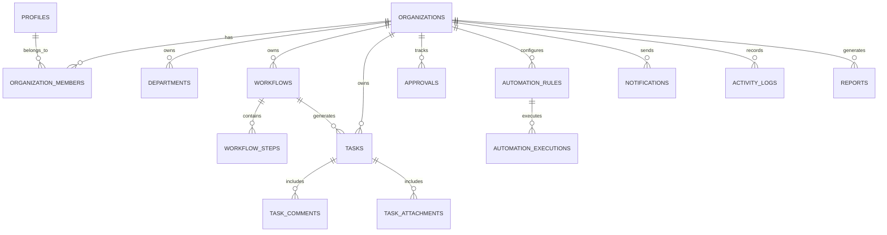

# SmartFlow AI - Database Schema & Row Level Security

The application uses **Supabase PostgreSQL** with full **Row Level Security (RLS)** to enforce multi-tenant organization isolation.

---

## Entity Relationship Overview

---

## Tables Summary

1. `profiles`: Mirrors `auth.users`, synchronized automatically via database trigger `handle_new_user()`.
2. `organizations`: Multi-tenant boundary. Each organization has a name, unique slug, and owner.
3. `organization_members`: Junction between profiles and organizations with roles (`admin`, `manager`, `employee`, `viewer`), active status, and assigned department.
4. `departments`: Operational teams (e.g. Operations, HR, Finance, Engineering, Sales).
5. `workflows`: Multi-step processes with category, priority (`low`, `medium`, `high`, `critical`), status (`draft`, `active`, `on_hold`, `completed`, `cancelled`), and target dates.
6. `workflow_steps`: Sequential stages with assigned roles, title, instructions, and order index.
7. `tasks`: Individual operational tasks with status (`to_do`, `in_progress`, `under_review`, `completed`, `blocked`), checklist JSON array, due dates, and assignees.
8. `task_comments`: Collaboration comments with author and timestamps.
9. `task_attachments`: Verified document uploads associated with tasks.
10. `approvals`: Requisitions with requested amounts, requester, approver, status (`pending`, `approved`, `rejected`, `info_requested`), and justification notes.
11. `automation_rules`: Trigger-Condition-Action rules configured per organization.
12. `automation_executions`: Execution records with idempotency key `(rule_id, event_id)` preventing duplicate triggers.
13. `notifications`: Personal alerts scoped to user IDs.
14. `activity_logs`: Immutable audit trails logging every significant action.
15. `ai_conversations` & `ai_messages`: User private AI interaction logs.
16. `reports`: Historical aggregated operational metrics with AI executive summaries.

---

## Row Level Security (RLS) Principles

1. **Organization Isolation**: Every organization-scoped table has RLS enabled with policies checking `public.is_member_of(organization_id)`.
2. **Role Enforcements**:
   - `admin`: Full administrative access to members, workflows, rules, and settings.
   - `manager`: Can author and manage workflows, assign tasks, review approvals, and configure automation rules.
   - `employee`: Can view assigned tasks, update checklist/status, submit approvals, and participate in task discussions.
   - `viewer`: Read-only access to authorized organizational records.
3. **Anti-Self-Approval**: Database policy and backend services disallow users from approving their own financial or operational requests.
4. **Idempotency Safeguard**: Unique constraint on `automation_executions(rule_id, event_id)` ensures automated actions are strictly executed once per event occurrence.

